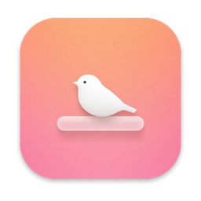
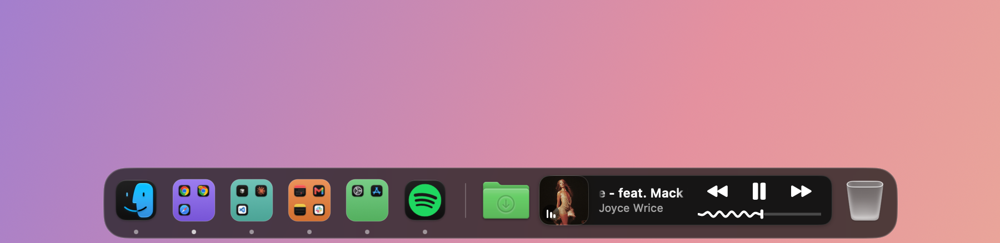
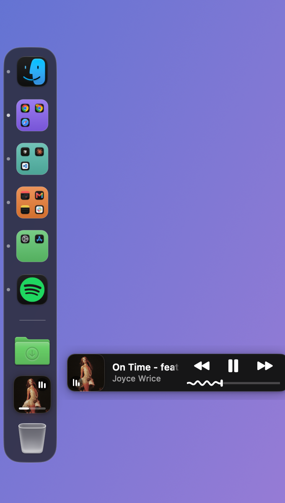

<p align="center">
  
</p>

# PerchDock

[](https://github.com/slynck/perchdock/actions/workflows/ci.yml)
[](LICENSE)

A faster, smarter Dock for macOS, with live window previews, app groups, a built-in music player and Liquid Glass styling. PerchDock takes over from the built-in Dock while it runs, and hands control back the moment you quit.

<p align="center">
  
</p>

## Why PerchDock

The built-in Dock shows one icon per app and little else. PerchDock keeps everything you're used to (clicking, dragging, badges, bouncing, right-click menus, hot corners) and adds the things people install three separate utilities for.

### Windows

- **Live window previews.** Hover an app to see thumbnails of its open windows. Hover a thumbnail to peek at that window, then click it to jump there.
- **Click to cycle.** Clicking a running app repeatedly steps through its windows. Scroll over an icon to flip between them, and middle-click a preview to close a window.
- **Move & Resize.** Right-click an app to tile its window to halves, quarters or full screen. **Bring to This Desktop** pulls a window over from another Space.
- **Windows stay clear of the dock.** With auto-hide off, zoomed or maximized windows are trimmed so they never slide underneath the dock.
- **Minimized windows** sit in their own section, just like the built-in Dock.

### Organizing

- **App groups.** Put several apps into one colored tile (right-click an app, then **New Group** or **Add to Group**). Hovering a group fans out its apps, and works in every dock position.
- **Dividers and folder stacks.** Add a divider anywhere, or pin any folder. Downloads and the Trash are built in.
- **Badges, bounces and new-window markers** behave like the built-in Dock.
- **Live icons.** Calendar shows today's date, even inside a group, and Clock's hands keep time.

### Widgets

- **Now Playing.** Shows the current song's cover art with play, pause and skip controls. It glows and shows a moving equalizer while music plays, and dims with a pause badge when it stops. Choose a compact tile or a large player with a scrubbable seek bar. On a side dock, the controls slide out next to the tile. It works with Spotify, Apple Music and anything else that reports to macOS's Now Playing.
- **Battery.** Your charge level at a glance.

<p align="center">
  
</p>

### Looks and placement

- **Glass styles.** Choose Liquid Glass, Clear Glass or Frosted, then set exactly how see-through the dock is. Tint colors, compact mode and running-indicator styles are also available.
- **Left, bottom or right.** Auto-hide and magnification work in every position.
- **Multiple displays.** Show the dock on the main display, on whichever display your pointer is on, or on every display at once.
- **Hot corners keep working**, even with the dock on the side of the screen.

### Menus

- **Quick settings from the menu bar.** Click the PerchDock icon in the menu bar, or right-click an empty part of the dock and open **Dock Options**. From there you can change position, auto-hide, magnification, transparency and widgets without opening Settings.
- **App menu actions.** Right-clicking an app shows the same extra actions the built-in Dock would offer, such as **New Window** or **New Incognito Window** in Chrome, or **Pause** and **Next** in Spotify.

## Requirements

- macOS 15 Sequoia or later. Liquid Glass styling needs macOS 26 or later; older systems use the frosted style.
- An Apple silicon or Intel Mac.

## Install

### From a release

1. Download the latest `PerchDock-x.y.z.dmg` from the Releases page.
2. Open it and drag **PerchDock** into **Applications**.
3. Open PerchDock from Applications.

> If macOS says PerchDock "can't be opened because Apple cannot check it", the build you downloaded isn't notarized. Right-click PerchDock in Applications, choose **Open**, then confirm. You only need to do this once.

### Build from source

You'll need Xcode 26 or later and [XcodeGen](https://github.com/yonaskolb/XcodeGen) (`brew install xcodegen`).

```bash
git clone <this repository>
cd <repository folder>
scripts/build.sh --install
```

`--install` copies the app to **Applications** and launches it from there. Use `--run` instead to launch it straight from the `build.noindex/` folder while developing (the `.noindex` suffix keeps that copy out of Spotlight).

`scripts/build.sh` creates a local signing identity the first time it runs, so the macOS permissions you grant survive rebuilds. To make a drag-to-install DMG in `dist/`, run `scripts/release.sh`.

To run the unit tests (dock layout, live icon clock hands, menu matching, settings migration):

```bash
xcodebuild -project PerchDock.xcodeproj -scheme PerchDock -derivedDataPath build.noindex test
```

## First launch: permissions

PerchDock asks for a few permissions so it can do what the built-in Dock does. Grant them in **System Settings → Privacy & Security**.

| Permission | What it's used for |
| --- | --- |
| Accessibility | Switching, cycling, tiling and closing windows. Reading app menu actions. Keeping windows clear of the dock. |
| Screen Recording | Live window preview thumbnails. |
| Automation (Finder, Spotify) | Emptying the Trash, and fetching Spotify cover art. Asked for the first time each is used. |

PerchDock works without Screen Recording. You'll see app icons in place of window thumbnails.

## Using PerchDock

- **Settings:** click the PerchDock icon in the menu bar, then **Settings…** (or press ⌘, while the menu is open).
- **Rearrange:** drag icons along the dock. Drag one off the dock to remove it.
- **Pin an app:** right-click it and choose **Keep in Dock**.
- **Add a folder:** right-click an empty part of the dock and choose **Add Folder to Dock…**.
- **Add a divider:** right-click an empty part of the dock and choose **Add Divider Here**.

## What happens to the built-in Dock

PerchDock doesn't delete or modify anything in macOS. While it runs, it tells the built-in Dock to stay hidden, the same way other dock replacements do. The built-in Dock process keeps running, so Mission Control, Spaces, app switching and hot corners keep working.

When you quit PerchDock, the built-in Dock comes back. You can turn this off with **Hide Native Dock** in the menu bar menu.

**If PerchDock crashes or is force-quit** and the built-in Dock stays hidden, run:

```bash
scripts/restore-native-dock.sh
```

If you don't have the source, run the same commands in Terminal:

```bash
defaults delete com.apple.dock autohide-delay
defaults delete com.apple.dock autohide-time-modifier
defaults write com.apple.dock autohide -bool false
killall Dock
```

## Uninstall

1. Quit PerchDock from its menu bar icon. The built-in Dock reappears.
2. Delete PerchDock from Applications.
3. Optionally remove its settings: `defaults delete com.slynck.perchdock`.
4. Optionally remove its entries under **System Settings → Privacy & Security**.

## Known limitations

- Only Calendar and Clock have live icons, which PerchDock draws itself. Other apps that animate their own Dock icon, such as Activity Monitor's graphs, show their regular icon, because macOS doesn't let another app read those.
- The Now Playing widget relies on a private macOS framework, so a future macOS update could break it until PerchDock is updated. PerchDock isn't eligible for the Mac App Store for the same reason.
- Builds made on your own Mac are signed with a local certificate and only run on that Mac. Sharing builds with other people needs an Apple Developer ID and notarization.

## Project layout

```
Sources/PerchDock/
  App/            App lifecycle, menu bar icon, display management
  Dock/           The dock window, tiles, widgets, previews and glass styling
  Services/       App tracking, window control, Now Playing, badges, native Dock menus
  Settings/       Settings storage, the Settings window and the quick-settings menu
  WindowPicker/   Window thumbnail capture and the preview panel
Tests/PerchDockTests/  Unit tests (Swift Testing)
scripts/          Build, release, signing setup and native Dock restore
project.yml       XcodeGen project definition (the .xcodeproj is generated)
.github/          CI: builds Debug and Release and runs the unit tests on every pull request and push to main
```

## License

PerchDock is free software under the [GNU General Public License v3.0](LICENSE).
